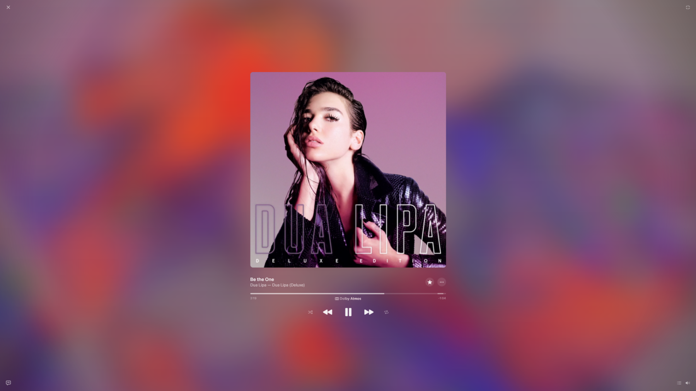
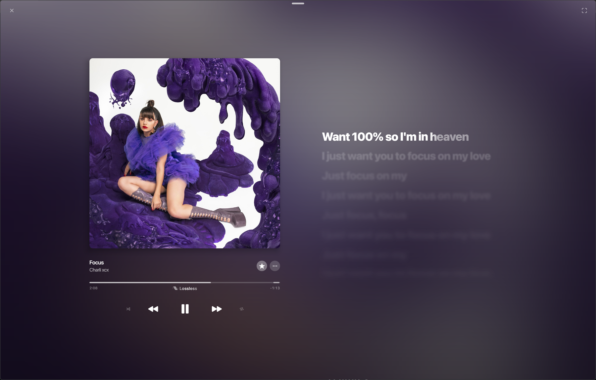
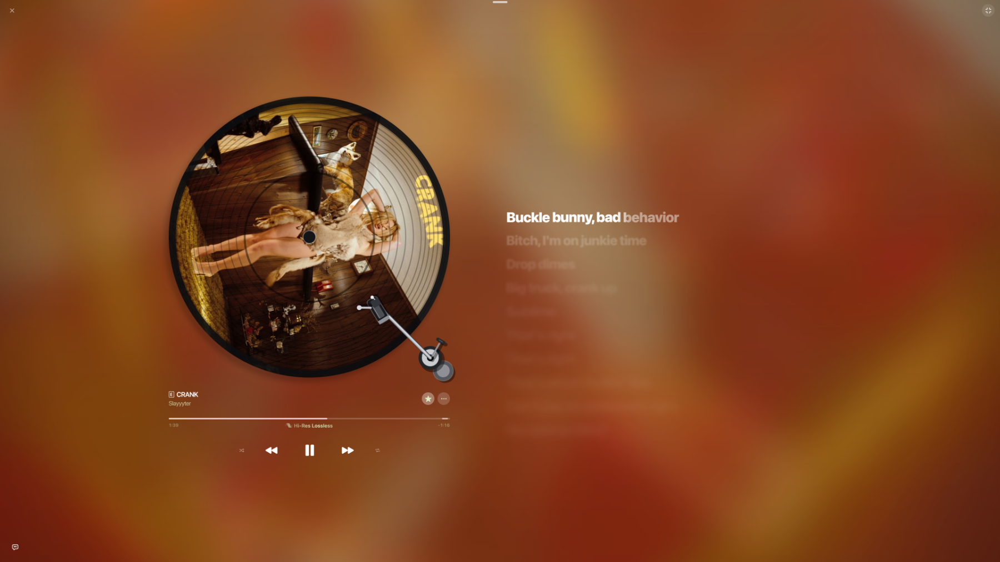

<div align="center">

<br/>


# BitChord for PC

### A YouTube Music desktop client, dressed by Apple Music

A Desktop player for Windows, macOS and Linux —
inspired by Apple Music's design, with support for lossless sources, beat-matched Automix and word-synced lyrics.

<br/>

[](https://github.com/jackychan4891/BitChord-PC-Continued/releases/latest)
[](https://github.com/jackychan4891/BitChord-PC-Continued/releases)
[](LICENSE)
[](https://github.com/jackychan4891/BitChord-PC-Continued/releases/latest)

<br/>

<a href="https://github.com/jackychan4891/BitChord-PC-Continued/releases/latest"></a>
<a href="https://github.com/jackychan4891/BitChord-PC-Continued/releases"></a>
<a href="https://github.com/jackychan4891/BitChord-PC-Continued/issues"></a>

<br/>

[**Screenshots**](#screenshots) · [**Features**](#features) · [**Install**](#install) · [**Build**](#build-from-source) · [**Credits**](#credits) · [**Disclaimer**](#disclaimer)

</div>

> [!IMPORTANT]
> BitChord is not affiliated with, endorsed by, or connected to YouTube, Google or Apple.
> Use it at your own discretion.

> [!TIP]
> Need help, want to hear about new releases first, or say what should come next?
> [Join the Discord server](https://discord.gg/cWQSGjpXM).

---

<div align="center">

<h2><a id="screenshots"></a>Screenshots</h2>



<br/><br/>

<table>
  <tr>
    <td width="50%"></td>
    <td width="50%"></td>
  </tr>
  <tr>
    <td align="center"><sub><b>Synced lyrics</b> — the sung line holds the anchor, the rest blurs away</sub></td>
    <td align="center"><sub><b>Turntable</b> — the sleeve becomes a spinning record</sub></td>
  </tr>
</table>

</div>

---

<div align="center">

<h2><a id="features"></a>Features</h2>

</div>

<table>
  <tr>
    <td width="50%" valign="top">

#### Playback
- **Anything on YouTube Music** — search, browse, albums, playlists, artist pages.
- **Apple music playlists** - sourced from Apple, played by youtube music.
- **Lossless, Hi-Res audio & Dolby Atmos** — FLAC/ALAC and Dolby Atmos from a configured module source, with YouTube
  Music as the fallback; switch output from the lossless badge.
- **Gapless playback with true crossfade** — 0–12 s, adjustable.
- **Automix** — beat-matched, phrase-aligned DJ transitions with a set of
  transition effects; it mixes on the stream already playing, so skipping never stalls
  waiting for a lossless download.
- **Downloads** — save tracks with embedded metadata, or a whole release at once.
- **Local library** — bring in music you already own.
- **SponsorBlock** — skips non-music segments.

#### Apple Music-style interface
- **Listen Now, New, Moods, Radio, Charts, Library, Search** — the web player's layout, shelves,
  tile shapes and typography, rebuilt in Compose.
- **Animated release artwork** — Apple Music's own motion covers on artist pages and the player.
- **Full-screen player** — artwork left, transport centred, live lyrics right.
- **Mini player** — frosted, artwork-driven, with progress and quick controls.
- **Artist pages** — Apple's discography shelves, tour dates, and the artist's own
  signature at the foot of the page where one is on file.
- **Window snapping** and borderless full-screen.

    </td>
    <td width="50%" valign="top">

#### Lyrics
- **Word-synced lyrics** from multiple providers, with automatic fallback.
- **Translation and romanisation** built into the player.
- **Apple-style follow-scroll** — the active line holds centre; sung lines fade and blur.
- Lyrics in the full-screen player and in the browse pages' side panel.

#### Accounts & integrations
- **Google sign-in** for your YouTube Music library and recommendations.
- **Spotify library import** — bring playlists and Liked Songs across.
- **Discord Rich Presence** — live track, artist, album and progress.
- **Last.fm scrobbling** — enter your own API key and secret in Settings.
- **ListenBrainz** scrobbling.
- **System media controls** via Windows SMTC, with seek and artwork.
- **Pluggable module sources** — add, edit, test and health-check them.

#### Radio & polish
- **Free live radio** — Apple Music's free stations and the BBC's national stations,
  with live now-playing and artwork.
- **14 interface languages**.
- **Nerd stats** — codec, bit depth, sample rate and more.
- **Memory-tuned** — bounded artwork and image caches keep the app well under 1 GB.

    </td>
  </tr>
</table>

---

<div align="center">

<h2><a id="install"></a>Install</h2>

<a href="https://github.com/jackychan4891/BitChord-PC-Continued/releases/latest"></a>

</div>

1. Open the [latest release](https://github.com/jackychan4891/BitChord-PC-Continued/releases/latest).
2. Download **`BitChord-<version>-windows-x64-setup.exe`** (installer) or
   **`BitChord-<version>-windows-x64.msi`** (Windows Installer package).
3. Run it. The app installs per user and adds a Start-menu entry.

**Requirements:** Windows 10 or 11, 64-bit. About 320 MB installed.

The builds are **not code-signed**, so Windows SmartScreen may show
"Windows protected your PC" — choose **More info → Run anyway**.

The app checks this repository for a newer release on launch and offers a download link
when one exists. Nothing is installed automatically.

---

<div align="center">

<h2><a id="build-from-source"></a>Build from source</h2>

</div>

You need **JDK 21** and a working CMake toolchain (the audio analyser is a native module).
All Gradle work is done from the repository root:

```bash
# run it
./gradlew :desktopApp:run

# portable app image -> desktopApp/build/compose/binaries/main/app/BitChord
./gradlew :desktopApp:createDistributable

# Windows installer (.exe) and MSI
./gradlew :desktopApp:packageExe :desktopApp:packageMsi
```

Stamp a version with `-Pbitchord.version=1.8.30`. Platform notes for Linux and macOS,
including the libraries Compose Desktop needs and the packaging targets for each
platform, are in [DESKTOP.md](DESKTOP.md). The release-file naming rules the in-app
update check depends on are in [docs/DESKTOP_RELEASES.md](docs/DESKTOP_RELEASES.md).

---

<div align="center">

<h2><a id="credits"></a>Credits</h2>

</div>

BitChord for PC is built on [BitChord](https://github.com/kushagrasinghx/BitChord) by
Kushagra Singh (GPLv3). The original Android client, its shared modules and its playback
engine are his work; this repository adds the desktop application and its Apple Music-style
interface.

- Lyrics providers: [LRCLIB](https://lrclib.net), [BiniLyrics](https://github.com/binimum),
  [BetterLyrics](https://github.com/better-lyrics/better-lyrics),
  [PaxSenix](https://lyrics.paxsenix.org), [LyricsPlus](https://github.com/ibratabian17/YouLyPlus),
  [SimpMusic](https://github.com/maxrave-dev/SimpMusic), [Unison](https://unison.boidu.dev),
  [Megalobiz](https://www.megalobiz.com), [KuGou](https://www.kugou.com),
  [Musixmatch](https://www.musixmatch.com), [Genius](https://genius.com) and
  [lrc.red](https://lrc.red).
- Lyrics animation inspired by [binimum/am-lyrics](https://github.com/binimum/am-lyrics).
- Design studied from the Apple Music web player. Apple Music is a trademark of Apple Inc.;
  this project is not affiliated with Apple.

---

<div align="center">

<h2><a id="disclaimer"></a>Disclaimer</h2>

BitChord is an independent, community-run third-party player. It is **not** associated with
Google LLC, YouTube, Apple Inc. or any of their parent companies.

- **No media hosting.** BitChord does not host, upload or store copyrighted music. It is an
  interface to public or user-authenticated APIs, plus your own local files.
- **Fair use.** The software is provided for personal, educational and research use. You are
  responsible for using it in line with your local copyright law and the terms of service of
  any service you connect it to.
- **No guarantees.** BitChord does not promise to bypass ads, DRM, subscriptions or regional
  restrictions, and makes no guarantee about third-party services.

---

<h2><a id="license"></a>License</h2>

This project is licensed under the **GNU General Public License v3.0**. See [LICENSE](LICENSE).

</div>
