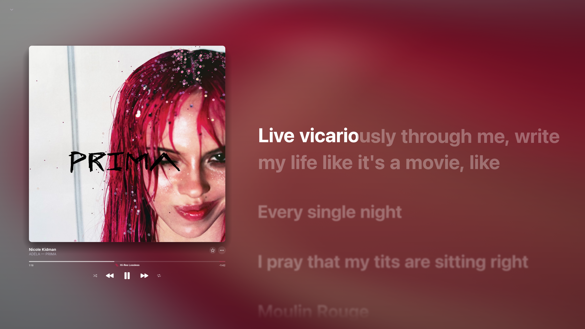
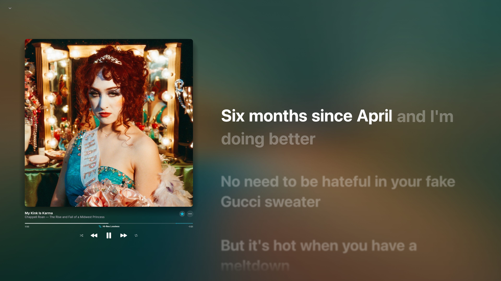
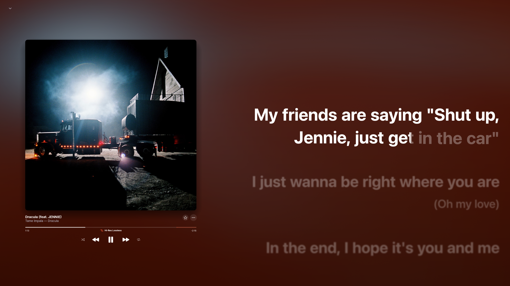

<div align="center">
  <h1>BitChord</h1>
  <p><strong>A fast, native YouTube Music desktop app — rebuilt in Rust.</strong></p>
  <p>Built with egui and rodio. No Electron, no embedded browser player, and light on memory while playing.</p>

  <p>
    <a href="https://github.com/jackychan4891/BitChord-PC-Continued/releases/latest"></a>
    <a href="https://github.com/jackychan4891/BitChord-PC-Continued/releases"></a>
    
    <a href="LICENSE"></a>
  </p>

  <p>
    <a href="https://discord.gg/cWQSGjpXM">Discord</a> ·
    <a href="https://github.com/jackychan4891/BitChord-PC-Continued/releases/latest">Download</a> ·
    <a href="#features">Features</a> ·
    <a href="#installation">Installation</a> ·
    <a href="#building-from-source">Build from source</a>
  </p>
</div>

> BitChord is an independent, unofficial client. It is not affiliated with, endorsed by, or connected to YouTube, Google, or Apple.

## Screenshots

<table>
  <tr>
    <td width="50%"></td>
    <td width="50%"></td>
  </tr>
  <tr>
    <td align="center"><b>Player</b> — artwork, lyrics, queue and playback in one view</td>
    <td align="center"><b>Browse</b> — your music, shelves and navigation</td>
  </tr>
  <tr>
    <td colspan="2"></td>
  </tr>
  <tr>
    <td colspan="2" align="center"><b>Desktop experience</b> — native UI, fast playback, and quality controls</td>
  </tr>
</table>

## Features

**Playback**
- **YouTube Music, natively** — search, browse, albums, playlists, artist pages, radio, mixes, charts and your library.
- **Lossless / Hi-Res Lossless / Dolby Atmos** — play higher-quality copies from configured hi-res addon sources when a matching copy is available, with YouTube audio as the fallback.
- **Quality controls in the player** — see the active audio quality, prefer Dolby Atmos when available, and revert or upgrade quality from the player menu.
- **Quality badge** — see whether the current stream is Opus, AAC, Lossless, Hi-Res Lossless or Dolby Atmos, toggled from the player menu or Settings › Playback.
- **Automix and crossfade** — DJ-style transitions between songs, with a mixing state shown in the player during transitions.
- **Queue and playback controls** — shuffle, repeat, autoplay, song radio, next-track prefetch, volume normalization, and output device selection.
- **Downloads** — save songs for offline playback.

**Lyrics and interface**
- **Synced lyrics** — timed lyrics with provider fallbacks, timing controls, romanization and translation options.
- **Native Rust desktop UI** — a fast egui/rodio interface with system media controls, tray integration, and keyboard-friendly navigation.
- **Discord Rich Presence** — show what you’re listening to on Discord.
- **Last.fm scrobbling** — connect your Last.fm account in Settings.

**Accounts and library**
- **Google sign-in** — unlock your YouTube Music feed, likes, playlists, history and recommendations.
- **Library and uploads** — access saved music and uploaded tracks where available.
- **Listen Together / jams** — start or join a shared listening session.
- **Spotify transfer** — bring playlists and liked music over from Spotify.

## Installation

Download the latest build from [Releases](https://github.com/jackychan4891/BitChord-PC-Continued/releases/latest).

- **Windows** — download the Windows release asset, extract/install it, and run `bitchord.exe`.
- **macOS / Linux** — use the platform release assets when available.

If Windows SmartScreen appears for an unsigned build, choose **More info → Run anyway**.

## Building from source

You need the [Rust toolchain](https://rustup.rs/).

```sh
git clone https://github.com/jackychan4891/BitChord-PC-Continued.git
cd BitChord-PC-Continued
cargo build --release
```

The built app will be in `target/release/`.

Platform builds may require native dependencies (audio/system libraries and toolchain components used by sign-in or platform integrations). Check the repository’s platform docs and release workflow for the exact prerequisites.

## Notes

- Audio and the main interface are native (Rust + egui + rodio). Sign-in and some web flows may open a system webview window.
- Hi-res/Lossless/Atmos playback depends on configured addon sources and whether a matching, playable copy exists for the selected track.
- BitChord does not bypass subscriptions, DRM, or regional restrictions. Availability depends on the services and sources you use.
- Third-party services (YouTube Music, lyrics providers, Discord, Last.fm, Spotify, addon sources) can change behavior over time.

## Contributing

Bug reports and pull requests are welcome. Please open an issue with clear reproduction steps, platform details, and relevant logs (with secrets/tokens removed).

## License

BitChord is licensed under [GPL-3.0](LICENSE).

## Acknowledgements

- [egui](https://github.com/emilk/egui) for the interface.
- [rodio](https://github.com/RustAudio/rodio) and Symphonia for audio playback and decoding.
- [ytm-rs](https://github.com/grapedjuice/ytm-rs) for the basic rust backend.
- Lyrics, metadata, playback, and integrations depend on the upstream libraries and third-party services used by this project.
